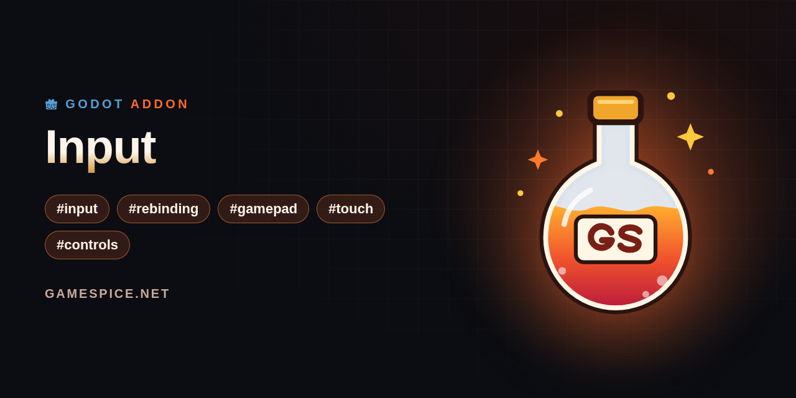

[](https://moddingcommunity.com/a/139-gs-input)

Godot 4.7+ addon for input: declared actions, device profiles for keyboard and mouse, gamepad and touch, rebinding with conflict detection, and one sampled intent per tick. Part of the [GameSpice](https://github.com/gamespice-platform) family. It needs only [GameSpice Core](https://github.com/gamespice-platform/core).

gs-input is a [GameSpice](https://gamespice.net) addon under the MIT licence. Claude Code wrote it, and `examples/input_selftest.tscn` is the headless suite. The games in [Zee's Games](https://zeesgames.com) are built on the GameSpice addons and run on live servers, so it sees real play and not just tests.

The addon is the data model: which actions a game has, what each device binds them to, who clashes, and what one tick of input looked like as plain values. The data model never reads `Input` or edits `InputMap`. `GSInputText` (event to short text and back, pure) and `GSInputMap` (apply text to `InputMap` actions) are the two classes that do the event step.

## Install

1. Copy `addons/gs_input/` and `addons/gs_core/` into your project.
2. Enable gs-input in *Project > Project Settings > Plugins*.

## Quick start

```gdscript
var cfg: GSInputConfig = GSInputConfig.from_files().value
var actions := GSInputActionSet.new()
actions.declare(&"fire", "button", {"kbm": ["mouse:1"], "pad": ["pad:rt"], "touch": ["touch:fire"]})
actions.declare(&"move_x", "axis", {"pad": ["pad:lx+"]})

# A rebinding screen
var result := actions.rebind(&"fire", "kbm", "key:F", cfg)   # fails loudly on a clash
if not result.ok:
    show_error(result.error.message)
var clashes := GSInputConflicts.find(actions, "kbm")        # for highlighting

# Once per tick, from whatever your device layer read
var intent := GSInputIntent.sample(actions, cfg, raw_values, previous_intent, tick)
if intent.pressed.has(&"fire"):
    shoot()
send_to_server(intent.to_dict())
```

## Settings

Every number is a field on `GSInputConfig`. The values below are defaults, and the ranges are inspector slider limits, not enforced caps. Set the property from code or a config file to go beyond them.

| Setting | Default | What it does |
| --- | --- | --- |
| `enabled` | true | Off, a sampled intent is always empty. |
| `gamepad_deadzone` | 0.2 | Stick and trigger values under this read as zero; the rest is rescaled. |
| `trigger_threshold` | 0.5 | An analogue value at or over this counts as a button held. |
| `conflict_policy` | 0 | A rebind onto a taken binding: 0 refuses, 1 takes it from the holder. |
| `max_bindings_per_action` | 0 | Bindings one action may hold per device; 0 is no limit. |
| `default_device` | `kbm` | The device a fresh profile starts on: `kbm`, `pad` or `touch`. |

Layers, weakest first: the defaults, `cfg/addon/gs_input/*.yml`, the game's files, the operator's files, `GS_INPUT_*` environment variables, then `--input-*` flags.

## What it is not

- Not the look and movement sampling of a player: GameSpice Player Controller owns look accumulation and turns input into movement. It can consume a `GSInputIntent`.
- Not a settings screen: GameSpice Menu owns the rebindable-key rows. This addon holds the actions and conflict rules those rows show.
- Not touch widgets: GameSpice Mobile owns the on-screen sticks and buttons. `touch:` bindings name them.
- Not the network input type: GameSpice Net owns `GSNetInput` and prediction. An intent converts to a dictionary a game can put in one.
- Not an anti-cheat: a server still validates every command.

## Used by

### Zee's Games

Zee's Games is a collection of games I made on GameSpice, for demonstration and for fun. They show what the platform can do, and they run on live servers you can join. Anybody can create games on GameSpice, and each addon is its own repository and can be used separately from the games and from the rest of GameSpice.

Games that vendor this addon:

- [Fatal Contact](https://zeesgames.com/fatal-contact)
- [Airdrift](https://zeesgames.com/airdrift)
- [Playlot](https://zeesgames.com/playlot)
- [Hungario](https://zeesgames.com/hungario)
- [Buses From Hell](https://zeesgames.com/buses-from-hell)
- [Smash Copter](https://zeesgames.com/smash-copter)
- [Zombie Zone](https://zeesgames.com/zombie-zone)
- [Hide n Seek](https://zeesgames.com/hide-n-seek)
- [Prop Hunt](https://zeesgames.com/prop-hunt)
- [Murder Mystery](https://zeesgames.com/murder-mystery)
- [Deathrun](https://zeesgames.com/deathrun)
- [Wipeout](https://zeesgames.com/wipeout)
- [Dangerous Delivery](https://zeesgames.com/dangerous-delivery)
- [Look At Me](https://zeesgames.com/look-at-me)

The whole collection is at [zeesgames.com](https://zeesgames.com).

## Licence

MIT.
